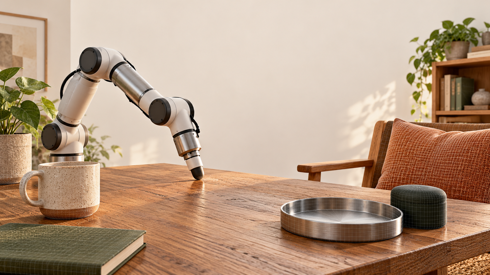
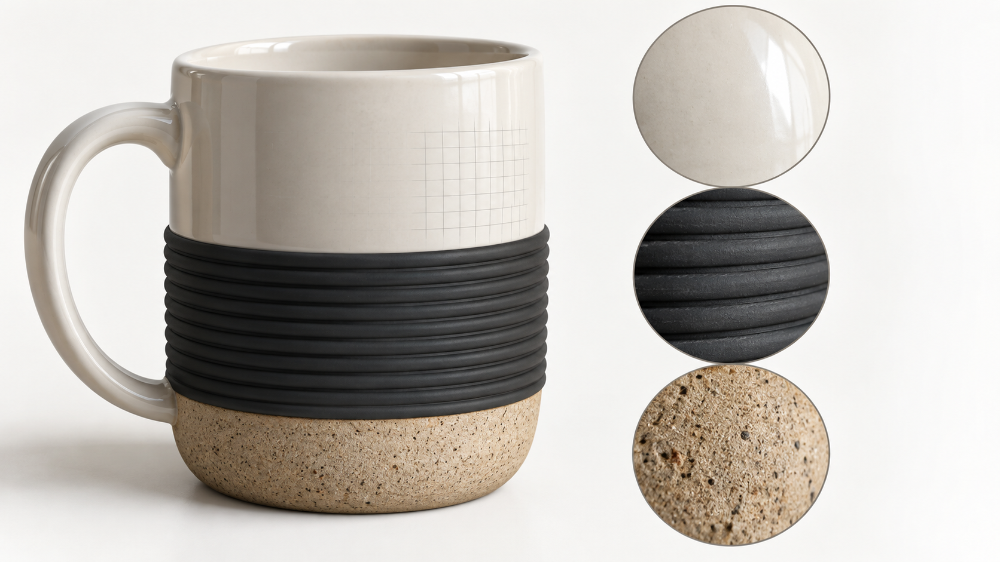
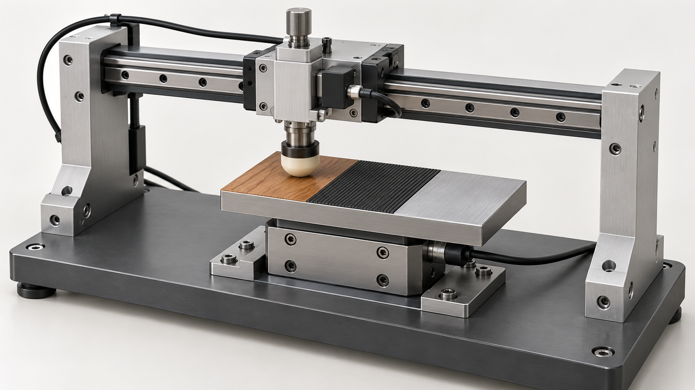
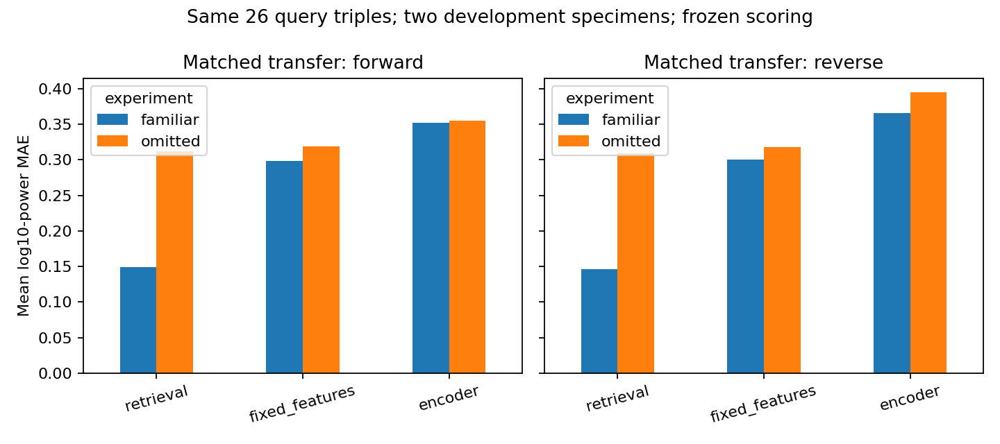

# Visual Assets for the Tactile Worlds Scientific Pitch

Illustrations prepared 11 October 2026; placement updated 12 October 2026 for the [12-slide scientific pitch](../tactile_worlds_research_pitch_12_slides.md).

The [standalone HTML presentation](../ruihan_gao_partnership_pitch.html) includes the selected figures, original illustrations, speaker notes and a 102-entry paper library. All slide images are embedded. Use arrows to navigate, N for notes, R for papers, F for fullscreen and O for the overview. The filename is historical; this version is a scientific pitch.

The three original illustrations below were created with the **built-in imagegen tool** and inspected. They contain no embedded text, invented numerical results or sensor measurements. Add their captions as editable slide text. Exact prompts are saved in [generation_prompts.json](generation_prompts.json).

The saved development chart is existing repository evidence. The selected paper figures are stored locally and embedded in the HTML with credits; their primary sources are recorded in [papers/sources.json](papers/sources.json). Keep the source credits on the slide.

## Recommended Slide-by-Slide Placement

| Slide | Recommended visual | Placement and label |
| --- | --- | --- |
| 1 — Tactile Worlds: A Room We Can Touch | [Room concept](01-tactile-room-vision.png) | Hero image. Caption: **AI-generated concept illustration. Proposed system.** |
| 2 — The Same Surface Changes with the Action | Editable action/outcome table | Make future-action queries concrete. |
| 3 — We Can Already Measure and Represent Touch | Editable capability map | Group sensors, material inference, data and encoders. |
| 4 — Tactile Assets and 3D Scenes Already Have Precedents | DreamFusion and PAT3D teasers | Representation and scene-generation evidence with primary credits. |
| 5 — Contact Simulation and Texture Rendering Are Available | Editable capability map | Distinguish sensory rendering, mechanics, throughput and solvers. |
| 6 — World Models Already Use Touch to Predict Outcomes | Editable research map | Distinguish forward prediction and action generation. |
| 7 — The Research Gap: Validated Reuse Across Interactions | Prominent question and evidence table | Explain the proposed contribution. |
| 8 — Surface Assets Drive Physics and Touch | [Spatial surface asset concept](06-tactile-surface-asset.png) | Caption: **AI-generated concept illustration. Proposed surface asset.** |
| 9 — Our Starting Point Is a Tactile Observation Model | [Saved development chart](05-existing-development-results.png) | Retain both orientations and the two-specimen qualifier. |
| 10 — First Study: Build One Measured Surface Asset | [Proposed sliding rig](07-proposed-sliding-experiment.png) | Caption: **AI-generated concept illustration. Proposed setup; acquisition feasibility unresolved.** |
| 11 — The Evidence That Would Make the Idea Convincing | Editable test matrix | Independent measurements, holdouts and comparison baselines. |
| 12 — From One Validated Surface to a Tactile World | Editable roadmap and prominent goal | Connect the first asset to predictive room scenes. |

## Original Illustration 1 — Room-Scale Vision

**File:** [01-tactile-room-vision.png](01-tactile-room-vision.png).

**Use:** Slide 1. The wooden table, woven cushion, ceramic mug, rubber surface and metal tray make the tactile-world ambition concrete. Subtle surface grids suggest digital assets.

**Exact caption:** AI-generated concept illustration. Proposed system.

**Layout:** The upper middle has negative space for a title. Keep the contact point and material variety visible. Set the title in editable slide text rather than baking it into the image.

## Original Illustration 2 — A Spatial Surface Asset

**File:** [06-tactile-surface-asset.png](06-tactile-surface-asset.png).

**Use:** Slide 8. The image illustrates different surface regions on one object and their local structure. It is a conceptual asset example, not a new technical result or a demonstrated force law.

**Exact caption:** AI-generated concept illustration. Proposed surface asset.

**Suggested editable labels:** Smooth ceramic; Ribbed rubber; Rough ceramic base; Object-coordinate surface regions.

**Layout:** Place beside the system table. If space is limited, use the mug and the three macro regions as one image rather than scattering separate crops around the slide.

## Original Illustration 3 — Proposed Contact Experiment

**File:** [07-proposed-sliding-experiment.png](07-proposed-sliding-experiment.png).

**Use:** Slide 10. The illustration shows the idea of a controlled translating probe, material patches and a force-sensing support. It is not a mechanical drawing, an existing instrument or a photograph of hardware you own.

**Exact caption:** AI-generated concept illustration. Proposed setup; acquisition feasibility unresolved.

**Suggested editable labels:** Translating probe; Known contact pad; Candidate material patches; Independent force measurement.

**Speaker clarification:** This proposed sliding experiment tests tactile and force response. Freely responding motion requires a separate validation setup with known mass, initial state and actuation.

## Existing Evidence — Current Development Results

**File:** [05-existing-development-results.png](05-existing-development-results.png). Copied without alteration from [matched_review_primary.png](../matched_review_primary.png).

**Use:** Slide 9. This is the strongest available visual of the current development comparison, showing retrieval, fixed features and the encoder in both orientations.

**Exact caption:** Saved development comparison, 10 October 2026. Two repeatedly exposed development specimens. Mean log10 band-power MAE; lower is better. Training-condition coverage differs between familiar and omitted fits.

**Speaker clarification:** Retrieval remains stronger than the encoder in these cells. This is a restricted development result, and no broad generalization or physical force/motion result follows from it. See the [matched development report](../matched_development_review.md).

## Primary Figures for Representation and Scene Foundations

### Tactile DreamFusion — Main Teaser

**Best fit:** Slide 4.

- [Direct figure: Fig. 1](https://arxiv.org/html/2412.06785v1/teaser_v4.png)
- [Official project](https://ruihangao.github.io/TactileDreamFusion/)
- [Paper](https://arxiv.org/abs/2412.06785)

**Exact credit:** Gao et al., *Tactile DreamFusion*, NeurIPS 2024, Fig. 1.

**Why use it:** Shows a concrete precedent for tactile-guided 3D texture and spatial surface fields.

**What it supports:** Tactile-guided geometric texture generation. It should not be described as measured contact-force or temporal vibration prediction.

### PAT3D — Official Teaser

**Best fit:** Slide 4, beside DreamFusion.

- [Direct teaser](https://simulation-intelligence.github.io/PAT3D/static/images/teaser.png)
- [Official project](https://simulation-intelligence.github.io/PAT3D/)
- [Paper](https://arxiv.org/abs/2511.21978)

**Exact credit:** Lin et al., *PAT3D*, ICLR 2026. Official project teaser. Ruihan Gao is a coauthor.

**Why use it:** Makes the connection to physics-assisted scene generation visible.

**What it supports:** Simulation-ready scene arrangement. It should not be described as a calibrated tactile room.

### Controllable Visual-Tactile Synthesis — Main Figure

**Best fit:** Supporting material for Slide 4; cited in the slide but not embedded as a third figure.

- [Direct figure: Fig. 1](https://arxiv.org/html/2305.03051v1/figure1_teaser.png)
- [Official project](https://visual-tactile-synthesis.github.io/)
- [Paper](https://arxiv.org/abs/2305.03051)

**Exact credit:** Gao, Yuan & Zhu, *Controllable Visual-Tactile Synthesis*, ICCV 2023, Fig. 1.

**Why use it:** Shows the connection between sketch input, generated visual/tactile content and physical haptic rendering.

**Layout:** Keep the complete pipeline legible if showing this supporting figure. The HTML uses two figures on Slide 4.

### Tactile DreamFusion — Texture Variations on Shared Geometry

**Best fit:** Supporting material for the asset-library milestone on Slide 12.

- [Direct figure: Fig. 6](https://arxiv.org/html/2412.06785v1/results_transfer_v3.png)
- [Official project](https://ruihangao.github.io/TactileDreamFusion/)

**Exact credit:** Gao et al., *Tactile DreamFusion*, NeurIPS 2024, Fig. 6. Prior-work texture examples on shared geometry.

**Why use it:** Makes an asset-library concept tangible. Keep the caption explicit that these are prior-work outputs and asset transfer in the proposed system requires validation.

## Primary Figures for Related-Work Evidence

### TACTO — Sensor Simulation Teaser

**Best fit:** Supporting material for Slide 5; not embedded in this version.

- [Direct image](https://raw.githubusercontent.com/facebookresearch/tacto/main/website/static/img/teaser.jpg)
- [Official repository](https://github.com/facebookresearch/tacto)
- [Paper](https://arxiv.org/abs/2012.08456)

**Exact credit:** Wang et al., *TACTO*, RA-L 2022. Official simulator teaser.

**What it supports:** Optical tactile rendering integrated with robot simulation. The project explicitly relies on external engines for contact dynamics.

### ObjectFolder 2.0 — Multisensory Asset Concept

**Best fit:** Supporting material for Slide 4; not embedded in this version.

- [Direct image](https://ai.stanford.edu/~rhgao/objectfolder2.0/concept.png)
- [Author project](https://ai.stanford.edu/~rhgao/objectfolder2.0/)
- [Paper](https://arxiv.org/abs/2204.02389)

**Exact credit:** Ruohan Gao et al., *ObjectFolder 2.0*, CVPR 2022. Author project concept figure.

**What it supports:** Object-centric multisensory assets. This is Ruohan Gao's work, not Ruihan Gao's work. It does not establish the proposed calibrated contact model.

### DiffTactile — Optional Sensor and Calibration Example

**Best fit:** Supporting material for Slide 5 if discussing calibrated mechanics.

- [Optical simulation image](https://difftactile.github.io/static/images/optical-sim.png)
- [Real press-slide interaction GIF](https://difftactile.github.io/static/gifs/press-slide-real.gif)
- [Simulated marker-motion GIF](https://difftactile.github.io/static/gifs/press-slide-sim.gif)
- [Official project](https://difftactile.github.io/)
- [Paper](https://arxiv.org/abs/2403.08716)

**Exact credit:** Si et al., *DiffTactile*, ICLR 2024. Official project visualization.

**What it supports:** A sensor/contact simulation and calibration example in its tested setup. Use the real and simulated GIFs together with their original labels, rather than implying either is your own experiment.

### RoboPack — Optional Future-State Prediction Example

**Best fit:** Supporting material for Slide 6 if discussing the world-model component.

- [Direct dynamics comparison](https://robo-pack.github.io/assets/img/dynamics-prediction-qualitative.png)
- [Official project](https://robo-pack.github.io/)
- [Paper](https://arxiv.org/abs/2407.01418)

**Exact credit:** Ai et al., *RoboPack*, RSS 2024. Official qualitative dynamics comparison.

**What it supports:** Tactile-informed future-state prediction. Its latent physics should not be labeled a calibrated friction coefficient.

## Suggested Visual Treatment

Use a light background and natural material colors to match the original illustrations. Add titles, labels and captions as editable slide text. Keep source figures at their original aspect ratios and preserve comparison labels. A few large, legible figures are more useful than a collage of many unreadable panels.

The opening image communicates the room-scale ambition, primary figures establish the scientific foundations, the saved chart establishes the current starting point, and the proposed rig makes the acquisition plan concrete. Keep the closing technical objective and questions visually simple.
