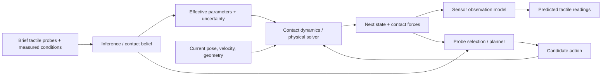

# Tactile research toward a contact physics world model

Reviewed **11 October 2026**, America/Los_Angeles. This is a research and architecture review of the current repository and a curated literature search, not a new experiment. The [paper dictionary](paper_dictionary.md) contains the bibliography, individual evidence/limitations, primary-source links, priorities and review depth. The [repository audit](repository_research_audit.md) traces current capabilities to code and saved reports.

## Contents

1. [Research conclusion](#research-conclusion)
2. [What we currently have](#what-we-currently-have)
3. [The model we are trying to build](#the-model-we-are-trying-to-build)
4. [What each literature branch contributes](#what-each-literature-branch-contributes)
5. [Closest prior work and research opportunities](#closest-prior-work-and-research-opportunities)
6. [Data and measurement readiness](#data-and-measurement-readiness)
7. [Recommended implementation sequence](#recommended-implementation-sequence)
8. [Search method and coverage limits](#search-method-and-coverage-limits)

## Research conclusion

**The strongest near-term route is a small, calibrated contact model with a separate tactile observation model.** This is our assessment from the repository and literature. The present project supplies useful machinery for evaluating how much information brief touches contain. Its missing bridge is independently measured contact force and resulting motion, together with a frozen test on new surfaces.

Tactile research offers complementary ingredients: observable contact geometry and slip; inference of effective mechanical parameters; calibrated sensor simulation; learned contact dynamics; and tactile-informed planning. These ingredients need different evidence. A good tactile reconstruction, material classifier, perceptually convincing waveform, successful policy and physically accurate force law answer different questions.

A tactile foundation encoder may improve the inference component. It becomes part of a world model when its state supports predictions under specified future actions and those predictions are evaluated. Large model size alone does not close the measurement gap.

## What we currently have

The code takes brief acceleration support spectra and a requested speed, direction and nominal load, then predicts **96 log-band-power values** for a different recorded contact. It implements five probe protocols, five simple baselines, a small encoder, strict acceleration-window boundaries, provenance and extensive saved computational validation. It does not implement a sequential physical state transition, mechanical force law, physics-engine coupling or real robot control. See the [audit](repository_research_audit.md#implemented-capabilities).

The latest [matched development report](matched_development_review.md) uses ten training specimens and two repeatedly exposed evaluation specimens. On the forward transfer domain, single-touch retrieval raw log10 band-power MAE changes **0.1494 → 0.3119** when transfer-speed responses are omitted; the encoder changes **0.3517 → 0.3550**. Lower is better. Removing those responses also shrinks the training pool, so the contrast does not isolate speed coverage at equal training-data size. Retrieval remains stronger, and second-direction versus repetition benefits are not stable. This supports retaining strong retrieval and fixed-feature baselines.

The [saved validation dated 10 October](matched_validation_review.md) reports 110 passing tests and exact replay of frozen predictions/features. We did not rerun experiments or inspect reserved signals during this review. Twenty specimens remain reserved according to the [study-design review](study_design_review.md). Physical acquisition timing remains unresolved: current duration and frequency labels use [logged coordinates](clock_qc_review.md).

The separate [brief-touch-mechanics repository](https://github.com/EltonChang1/brief-touch-mechanics) also states that it contains a proposed experiment with no force or motion results. Its implementation and data collection are future work, as checked in its public README during this review.

## The model we are trying to build

Use four explicit interfaces. This is a proposed architecture; only a restricted support-to-spectrum inference/observation path exists today.

| Interface | Meaning | Required validation |
| --- | --- | --- |
| Inference / belief | Probe history and known actions → uncertain contact state and effective parameters | Independent force, pose, deformation and contact-state labels; parameter ambiguity checks |
| Dynamics | State + action + contact law → next state and force | Held-out force trajectories and multi-step position/velocity rollouts |
| Observation | Contact state + sensor model → predicted tactile readings | Sensor residuals, spectra/waveforms or images; calibration and timing |
| Planning | Belief + candidate actions + predicted outcomes → next probe or task action | Matched probing cost and real task outcome comparisons |

For the first mechanics milestone, fix the pad, geometry and surface preparation, model one-direction sliding, and infer only parameters supported by the excitation. A constant-speed touch may estimate an effective friction level; it cannot independently identify an unrestricted speed law, stiffness, damping and geometry. Represent sticking, partial slip and sliding distinctly when measurements support them. Add deformation only after calibrating the sensor, fixture and object contributions.

An alternative is a learned latent transition model for planning. It can predict useful outcomes without naming each physical parameter, as [RoboPack](https://arxiv.org/abs/2407.01418) illustrates. Such a latent should be evaluated through motion/force prediction and interventions; do not interpret its dimensions as calibrated friction coefficients without separate tests.

## What each literature branch contributes

| Branch | Important anchors | Contribution and boundary |
| --- | --- | --- |
| Sensors and physical observability | [GelSight](https://www.mdpi.com/1424-8220/17/12/2762), [DIGIT](https://arxiv.org/abs/2005.14679), [ReSkin](https://proceedings.mlr.press/v164/bhirangi22a.html) | Select a measurement interface. Optical deformation, magnetic skin and vibration require different calibration and observation models. |
| Force, contact state and mechanics | [GelSlim inverse FEM](https://arxiv.org/abs/1810.04621), [shear/slip](https://people.csail.mit.edu/yuan_wz/GelSight1/ICRA15_2740_FI.pdf), [TacTID](https://charon-bo.github.io/assets/PDF/TacTID.pdf) | Recover state/force or effective parameters. Sensor-specific inference is a bridge to dynamics, not by itself a complete transition model. |
| Vibration and texture models | [Classical AR rendering](https://pubmed.ncbi.nlm.nih.gov/25248220/), [Heravi action-conditioned generation](https://arxiv.org/abs/1909.13025), [Cluster](https://arxiv.org/html/2407.16206v4) | Closest branch to the current spectral task. Measure generalization and rendering separately from force/motion accuracy. |
| Representation learning | [Touch and Go](https://arxiv.org/abs/2211.12498), [Sparsh](https://arxiv.org/abs/2410.24090) and the [representation catalog](paper_dictionary.md#representations-multimodal) | Transferable tactile features and evaluation tools. Classification, alignment or reconstruction need additional sequential dynamics training. |
| Tactile simulation | [TACTO](https://arxiv.org/abs/2012.08456), [Taxim](https://arxiv.org/abs/2109.04027), [DiffTactile](https://arxiv.org/abs/2403.08716) | TACTO renders observations using external mechanics; DiffTactile models deformable/contact mechanics and fits force/marker parameters. Compare image fidelity, force accuracy and motion independently. |
| Numerical dynamics | [MuJoCo](https://doi.org/10.1109/IROS.2012.6386109), [compliant contact formulation](https://arxiv.org/abs/2110.10107), [physics catalog](paper_dictionary.md#physics-foundations) | Existing solver infrastructure, constitutive/contact assumptions and differentiable methods. Gradients enable fitting; they do not guarantee correct or identifiable parameters. |
| Predictive world models | [RoboPack](https://arxiv.org/abs/2407.01418), [VT-WM](https://arxiv.org/abs/2602.06001), [ContactWorld](https://arxiv.org/abs/2606.13877) | Contact-aware outcome prediction and planning. Inspect future-action interfaces, object/scene holdouts and rollout horizons before transferring claims. |
| Active touch and control | [Bayesian texture exploration](https://www.frontiersin.org/journals/neurorobotics/articles/10.3389/fnbot.2012.00004/full), [predictive interactive perception](https://arxiv.org/html/2411.09020v1) | Choose informative actions from current uncertainty. Compare against repetitions at the same total sensing, travel and settling cost. |

The dictionary also covers ObjectFolder variants, cross-sensor tactile encoders, additional sensor families, newer tactile simulators, learned mesh/particle simulators, and 2026 prediction/action models. These are useful extensions after the closest baselines and physical measurement interfaces are established.

## Closest prior work and research opportunities

| Prior work | What overlaps | What our proposed study would still need to establish |
| --- | --- | --- |
| [Heravi 2019/ICRA 2020](https://arxiv.org/abs/1909.13025) and [later texture system](https://arxiv.org/abs/2212.13332) | Tactile input plus action conditions → vibration; later nearest-representation transfer | Brief moving acceleration supports, strict matched budgets, new surfaces and strong simple predictors; no novelty claim from merely adding an encoder |
| [How Much Haptic Surface Data Is Enough?](https://www.cs.utexas.edu/~jsinapov/AAAI-SSS-2017/paper/Burka_AAAI_SSS_2017.pdf) | Online force/speed friction fitting and stopping | The proposed brief budget and unseen-surface accuracy; its one-surface stopping result does not establish either |
| [DiffTactile](https://arxiv.org/abs/2403.08716) | Contact/sensor calibration from measured forces and markers | Brief new-surface identification, uncertainty and independent force/motion transfer beyond its calibration setup |
| [TacTID](https://charon-bo.github.io/assets/PDF/TacTID.pdf) | Friction/effective-stiffness inference from calibrated optical measurements | Whether vibrations add information beyond measured force/conditions and whether inferred parameters improve new motion rollouts |
| [RoboPack](https://arxiv.org/abs/2407.01418) | Tactile physics inference, action-conditioned dynamics and real manipulation | One frozen brief calibration compared with continued touch; specified contact-pair transfer and calibrated mechanics |
| [Predictive interactive perception](https://arxiv.org/html/2411.09020v1) | Property belief, graph dynamics and information-gain probes | A short fixed-budget surface test; its five-second interactions and quasi-static planar setting differ from our target |
| [VT-WM](https://arxiv.org/abs/2602.06001), [ContactWorld](https://arxiv.org/abs/2606.13877), [VT-WAM](https://arxiv.org/abs/2607.02503) | Modern multimodal predictive representations and task/action generation | Candidate-action-conditioned mechanics, counterfactual evaluation and force-calibrated generalization; these model interfaces are not interchangeable |

[VT-WAM](https://arxiv.org/html/2607.02503v1) jointly generates future tactile latents and actions; its tactile attention masks action keys. [VT-WM](https://arxiv.org/html/2602.06001v1) and [RoboPack](https://arxiv.org/html/2407.01418v1) expose candidate actions to forward prediction. This distinction matters when selecting a model for counterfactual physical rollouts.

The defensible research opportunity is **information-efficient contact adaptation under explicit measurement and evaluation budgets**. Study when brief tactile data improves over action-only, force-only, retrieval and simple calibrated mechanics, then test whether that improvement survives independent motion rollouts. This is a candidate research direction, not a verified novelty claim.

A useful negative result remains publishable evidence only if the measurement and study design are sound. Current development findings favor simple methods and do not yet establish the population claim or publication novelty.

## Data and measurement readiness

| Resource | Useful measurements / role | Readiness for this goal |
| --- | --- | --- |
| [Cluster](https://arxiv.org/html/2407.16206v4) | Controlled acceleration, normal load and position; current sensor-response study | Already integrated for bounded development. Missing synchronized scan tangential-force and indentation labels; physical timing unresolved locally. |
| [Penn HaTT](https://is.mpg.de/hi/publications/culbertson14-hs-texture) | Freehand acceleration/force/position; classical texture/friction models | Promising paired-channel candidate. Archive access, channel calibration/alignment, license and independent trial coverage still need inspection. |
| [LMT](https://www.ce.cit.tum.de/en/lmt/forschung/datensaetze/texture-database/) | Controlled/freehand texture recordings and later multimodal releases | Good observation transfer/feature benchmark. Verify the actual release schema; older procedures cannot certify newer archives. |
| [MIT planar pushing](https://web.mit.edu/mcube/push-dataset/) | Pusher/object pose and planar wrench; forward dynamics benchmark | Separate mechanics benchmark without paired texture touch. Author release warns streams are not synchronized. |
| [Touch and Go](https://arxiv.org/abs/2211.12498), ObjectFolder and representation datasets | Vision-touch alignment, objects and tactile representation tasks | Useful pretraining or sensor generation. Their data cannot be assumed to provide controlled independent force/indentation/motion labels for our contact pair. |
| [Sparsh/TacBench force task and ToucHD](https://arxiv.org/html/2410.24090v1) | Optical touch with force supervision; possible force-head training | Verify force calibration, contact setup and label construction for the intended use; it does not supply complete free-body dynamics. |
| [STAG](https://stag.csail.mit.edu/) | Distributed human-hand pressure maps and images | Useful whole-hand observation priors; lacks robot-action-conditioned physical rollouts for our pad/surface pair. |
| [RoboPack](https://arxiv.org/html/2407.01418v1) | Robot state/action trajectories and deformation-derived tactile force proxies | Useful task dynamics precedent. Proxies and latent physics are not independently calibrated force-law parameters. |
| [SPOTS](https://arxiv.org/html/2304.11193v2) | Planned-action-conditioned future video and normal/shear taxel vectors | Useful non-optical prediction precedent. Its paper explicitly calls the taxel forces uncalibrated; straight-line pushing restricts action coverage. |
| A calibrated fixed-pad rig | Independent normal/tangential force, position, acquisition clock and confirmed slip | Needed if archives cannot answer the restricted force question. A prescribed slide validates force; independently moving objects are needed to validate motion. |

There is no verified ready-to-train corpus in this review that supplies all brief supports, controlled independent queries, calibrated forces, indentation and freely responding motion for the same new contact pairs. That is a feasibility question to resolve before committing to a large model.

## Recommended implementation sequence

1. **Finish the observation study.** Freeze cohort/coverage, practical-effect margin and secondary policy; complete the planned development coverage and implement guarded locked scoring. Preserve the twenty reserved specimens. Treat the clock convention explicitly and keep retrieval/fixed-feature controls.
2. **Resolve mechanical acquisition.** Inspect candidate data or calibrate a rig. Verify independent tangential/normal forces, displacement, acquisition timing and sliding. Report full probing time, approach/settling and travel.
3. **Start with a minimal contact law.** Compare a global coefficient, brief force-ratio/Coulomb estimate, Coulomb-plus-viscous model when observable, retrieval and tactile-assisted inference. Compare force-only with force-plus-tactile. Reserve more complex friction models for measured residual structure.
4. **Test force transfer before engine integration.** Hold out complete contact pairs/surfaces and sessions. Score independent later speeds/loads with fixed budgets; retain longer calibration as a separately costed reference. Propagate uncertainty rather than claiming one touch identifies all properties.
5. **Validate dynamics.** Use an independently moving body; compare force, position, velocity and stopping outcomes across horizons. Check timestep/contact settings and native/custom friction interaction. A motor-enforced trajectory cannot validate free motion.
6. **Add a sensor renderer and one task.** Retain the current spectral predictor as a separate observation baseline. Add optical/temporal models only for the chosen sensor and test their incremental benefit. Compare identical planners/controllers using global, brief-inferred and longer-calibrated models.
7. **Expand after these gates.** Active probes, tactile foundation encoders, learned residuals, deformation and multiple contact geometries become meaningful extensions once force and motion evidence supports them.

Each step can succeed with a simple model. Scaling learning should answer an observed limitation, while preserving the same measurement and comparison contract.

## Search method and coverage limits

The search began with the repository's six-entry related-work matrix and existing mechanics methods, then followed primary paper, author project, publisher/proceedings and official code/data links. Parallel branches covered sensors/observability, contact mechanics and active exploration, tactile simulation/numerical physics, and representations/predictive models. Recent searches extended through **11 October 2026**.

Representative query families included tactile contact system identification friction stiffness; action-conditioned haptic texture force speed; tactile world model/contact dynamics 2026; vision-based tactile simulator/differentiable contact; tactile foundation encoders/cross-sensor transfer; Bayesian tactile exploration; and synchronized texture or pushing datasets. Closest overlaps received targeted methods/evaluation review. Broader entries received abstract/metadata triage, with their depth and sections recorded.

This is a **curated research map**, not an exhaustive systematic review, citation-ranking exercise or claim to include every important tactile paper. It prioritizes contributions to the four interfaces above. Clinical touch, prosthetics, psychophysics, fabrication, communications and generic policy learning are included only where they affect those interfaces. Peer-reviewed work and preprints are distinguished; conference acceptance and resource availability are not inferred when unverified.

The catalog stores stable IDs and source dates. Some preprints change title, authors or venue status; first manuscript years differ from journal years. Null code/data fields mean unverified. Official release links were checked as references, not installed or downloaded. No paper experiment, benchmark result, license entitlement or hardware feasibility was independently reproduced by this documentation task.
